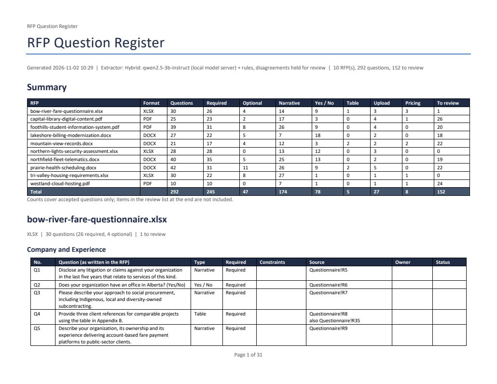
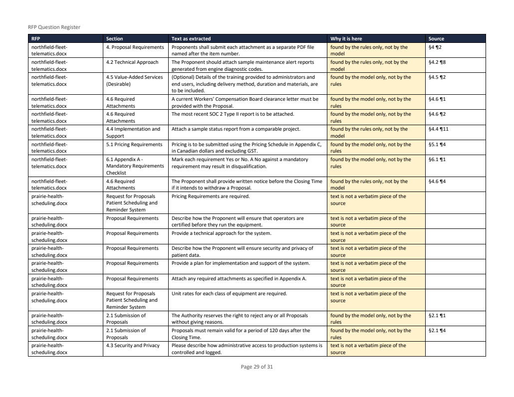

# RFP question extractor

Pull the questions out of RFPs in Word, PDF and Excel and put them in **one Word register with the same layout every time**.
A rules baseline and a small local model decide what is a question; code checks every answer against the source and writes the
document. A proof of concept, built and tested on **synthetic** RFPs only.



> **These are not real RFPs.** The ten files in `data/synthetic/` are invented: the issuers, numbers and dates do not exist, and
> nothing here comes from a real solicitation or from anyone's work. Results on them say how the pipeline behaves, not how it
> will do on your documents. Do not put confidential RFPs into this repository.

## How it works

```
Word / PDF / Excel ─▶ read ─▶ chunk ─▶ extract ─▶ verify ─▶ merge duplicates ─▶ Word register
                      no model  by section,  rules, or a   code: verbatim,   code            template, no model
                                page, sheet  local model   location, section
```

1. **Read** (`ingest.py`, python-docx, pdfplumber, openpyxl): headings, paragraphs and table rows, each with its section and a location a person can
   find (`§4.2 ¶3`, `p.5 L12`, `Questionnaire!R12`). Running headers and footers, contents lines with dot leaders and page numbers pasted into
   the body are marked as noise (counted, not hidden). Merged Excel cells are filled, hidden sheets skipped.
2. **Chunk** (`chunking.py`): 1,400 characters or so per piece, cut along the document's own structure; a table's header row is repeated for every piece.
3. **Extract**, with one of two interchangeable extractors: regular expressions (`baseline.py`, no model) or a local model through
   LM Studio (`llm_extract.py`): nine short rules, three worked examples, a JSON schema on the reply, one retry that sends the validation error back.
4. **Verify** (`validate.py`): the question must be a contiguous piece of the chunk the model was shown (layout, quotes and a final full stop
   aside). Number, section and location are **taken from the source, never from the model**. Anything that fails goes to the review list.
5. **Merge duplicates** (`dedupe.py`): identical wording is merged and both locations kept; reworded repeats are flagged, never merged.
6. **Render** (`render.py`, docxtpl): fills `templates/question_register.docx`. All layout lives in that Word file.

The model decides *what is a question*, its type, whether it is required and its constraints. It never decides where something is,
how it is numbered or what it is called, and nothing it writes reaches the register unless it is a verbatim piece of the source.

## Quick start

```bash
uv sync
uv run rfpx run data/synthetic/rfps -o out/register.docx              # rules only: no model, about two seconds
uv run pytest                                                          # tests, no model needed
uv run ruff check src tests scripts docs
```

With a local model (LM Studio, `http://127.0.0.1:1234/v1`; the client refuses any other host):

```bash
lms server start && lms load qwen2.5-3b-instruct -c 8192 -y
uv run rfpx run data/synthetic/rfps -o out/register.docx --extractor llm       # the model only
uv run rfpx run data/synthetic/rfps -o out/register.docx --extractor hybrid    # model + rules; disagreements go to review
lms unload --all && lms server stop
```

| Command | What it does |
|---|---|
| `rfpx run INPUT -o OUT.docx` | a folder (or one file) of `.docx`, `.pdf`, `.xlsx` to one register; `--extractor rules\|llm\|hybrid`, `--recheck`, `--template` |
| `rfpx eval --extractor ... --split dev\|test\|all --out FILE.json` | precision and recall against the answer keys, by verbatim match |
| `rfpx samples` | regenerate the synthetic RFPs and answer keys (seeded, so the same every time) |
| `rfpx template` | rewrite `templates/question_register.docx` |
| `rfpx llm-status` | is the model server up and which model would be used |

Without a model server every command still works: `llm` falls back to the rules for the chunk, flags what it found for review, and says so in the register.

## The register

Per RFP, then per section: number as printed, **the question word for word**, type (narrative, yes/no, table, upload, pricing),
required or optional, constraints (page, word and file limits, formats, amounts), source location, and blank **Owner** and **Status**
columns for the team. A summary table opens the document; a **Needs human review** list closes it, with the reason each item is there.
Edit styles (`Heading 1`, `RFP Table Text`, ...), column widths, header and footer or any fixed wording in Word; the next run follows.
Leave the `{{ }}` and `` tags alone.



Both pictures are from the hybrid run with the 3B model, so the review list is long. The "not a verbatim piece of the source" rows are the check doing its job:
on chunks with nothing to extract (covers, contents pages) the small model sometimes hands back a worked example from its own prompt, lightly reworded.

## Results

Ten synthetic RFPs (four Word, three PDF, three Excel), 350 distinct questions. A prediction counts only if its words equal the answer key's
(layout, typographic quotes and a final full stop aside). **Dev**, three files, is where the prompt and the chunk size were tuned. **Test**, seven
files, was not touched while tuning. Everything below is regenerated from `artifacts/reports/*.json` by `scripts/results_table.py`.

<!-- results:start -->
| Extractor | Test precision | Test recall | Test F1 | Test recall incl. review list | Items in review (test) | Dev F1 |
|---|---|---|---|---|---|---|
| Rules (regular expressions, no model) | 0.970 | 0.871 | 0.918 | 0.871 | 0 | 0.947 |
| qwen2.5-3b-instruct | 0.872 | 0.911 | 0.891 | 0.911 | 36 | 0.947 |
| &nbsp;&nbsp;+ second pass for missed items | 0.900 | 0.924 | 0.912 | 0.924 | 37 | 0.944 |
| &nbsp;&nbsp;without the section gate | 0.830 | 0.911 | 0.869 | 0.911 | 24 | 0.910 |
| &nbsp;&nbsp;without JSON-schema decoding | 0.895 | 0.876 | 0.885 | 0.876 | 33 | 0.951 |
| Hybrid: qwen2.5-3b + rules, disagreements to review | 0.984 | 0.800 | 0.882 | 0.982 | 108 | 0.923 |
| &nbsp;&nbsp;+ second pass for missed items | 0.989 | 0.804 | 0.887 | 0.982 | 99 | 0.923 |
| qwen3.8-27b, reasoning off | 0.991 | 1.000 | 0.996 | 1.000 | 0 | 0.996 |

| Test split | Word (3 files) | PDF (2 files) | Excel (2 files) |
|---|---|---|---|
| Rules | P 0.970 / R 0.923 | P 0.933 / R 0.667 | P 1.000 / R 1.000 |
| qwen2.5-3b | P 0.802 / R 0.894 | P 0.885 / R 0.857 | P 1.000 / R 1.000 |
| Hybrid | P 0.978 / R 0.846 | P 0.971 / R 0.540 | P 1.000 / R 1.000 |
| qwen3.8-27b | P 0.990 / R 1.000 | P 0.984 / R 1.000 | P 1.000 / R 1.000 |

| Test split, matched questions | Type correct | Required correct | Number correct |
|---|---|---|---|
| Rules | 0.990 | 1.000 | 1.000 |
| qwen2.5-3b | 0.756 | 0.902 | 1.000 |
| Hybrid | 0.761 | 0.906 | 1.000 |
| qwen3.8-27b | 0.960 | 1.000 | 1.000 |

| Why an item is in the review list (all 10 files) | qwen2.5-3b | Hybrid | qwen3.8-27b |
|---|---|---|---|
| text is not a verbatim piece of the source | 27 | 27 | 0 |
| found under a heading that normally holds background or instructions, not questions | 22 | 0 | 0 |
| text runs across more than one paragraph or table cell | 3 | 3 | 0 |
| found by the model only, not by the rules | 0 | 87 | 0 |
| found by the rules only, not by the model | 0 | 31 | 0 |
| **Items in the review list** | **52** | **148** | **0** |
| of which are real questions from the answer key | 0 | 58 | 0 |
<!-- results:end -->

## What the numbers say

- **On clean wording the regular expressions are hard to beat.** They are exact on the Excel files and very precise everywhere. They lose on wording nobody
  planned for (passive and nominal sentences) and on a requirements table whose header they do not recognise: that one table holds 16 of the 26 questions of one PDF,
  which is most of why PDF recall is low.
- **The 3B model finds what the rules cannot, and gets other things wrong.** Its recall is higher, its precision lower, and its labels (type, required)
  are clearly worse than the rules'. Alone it does not beat the baseline on F1.
- **The checks around the model matter as much as the model.** The section gate (items under Background, Definitions or Instructions headings go to review)
  is worth about two F1 points; the second pass for missed items is worth about two more; JSON-schema decoding changes little for this model but guarantees parseable replies.
- **Agreement is a cheap confidence signal.** In the hybrid, only what the model and the rules both found is accepted: precision above 0.98. A person then
  decides the disagreements, which is how recall including the review list gets close to 0.98, at the price of a long list.
- **A 27B model with its reasoning switched off is close to perfect here**: test F1 0.996, nothing in the review list, at two to three and a half minutes per
  document (the 3B takes 10 to 25 seconds, the rules no time). That says as much about how clean the synthetic set is as about the model; with a model this good the checks stop being what limits quality.
  The first 27B run scored recall 0.600 for a reason that had nothing to do with the model: the client's `/no_think` suffix did not stop it reasoning, the reasoning used up
  `max_tokens` and 5 of 12 chunks came back empty and fell back to the rules. Sending `reasoning_effort: none` fixed it (details in `artifacts/reports/dev-tuning/NOTES.md`).

How the prompt got where it is (dev split): 3 examples and 2,400-character chunks gave F1 0.905; smaller chunks and two extra rules, 0.914; a fourth example showing an
excerpt with nothing to extract made it *worse* (0.854, the model began rewording) and was dropped; the section gate then took it to about 0.95.
Repeating one configuration moved dev F1 by up to 0.004 (the model server is not bit-for-bit repeatable), so differences smaller than that mean nothing.

## Limits

- **Synthetic, and written by one person.** The same author wrote the documents, the rules and the prompts. The first version of the set was too regular
  (the rules scored F1 0.96); I made the wording messier and added sentences that borrow question wording but ask for nothing, then fixed three plain oversights in the rules
  (a question mark followed by "(Yes/No)", "Please", bullet glyphs) and stopped. I did not add rules for the passive wording or the unusual table header, which is what overfitting to this set would look like.
  Real RFPs are messier than this; expect lower numbers.
- **Small.** Seven test files, 225 questions: one file moves a number by several points.
- **What counts as a question is a labelling choice.** Sentences that only introduce a list are not questions, their lettered items are; procedural sentences ("Proposals shall be
  submitted before the Closing Time") are not; the instruction to complete a pricing table is. Another team might label differently.
- **Verbatim, not semantic.** A model that rewords a question correctly is still a miss and a false positive here, and goes to review. That is the intended trade.
- **Not handled:** scanned PDFs (no OCR), two-column PDF layouts, Word lists whose numbers are generated by Word (the number is not in the text, so `No.` shows a dash), text boxes, tables nested inside table cells, comments and tracked changes,
  languages other than English, near-duplicates across different RFPs.
- **Labels from the small model are weak.** Its type and required labels are right far less often than the rules'; a production version should take them from the rules where the rules are sure.
  The 27B is better but still behind the rules on type.
- **No real RFPs were used.** Public files are listed in `docs/public-sources.md`, not downloaded; nothing confidential was ever in this repository.

## Without Python: Microsoft Copilot

The pipeline's logic can be repeated, partly, inside Microsoft 365 Copilot with Agent Builder, Word and Excel. `docs/copilot-guide.md` has the
agent instructions, pasteable prompts, manual chunking, a substitute for the substring check, how to get one layout, what cannot be done,
and a list of what to verify in your own tenant first. `docs/copilot_snippets.py` is the code-interpreter route.

## Layout

```
configs/rfpx.yaml          chunk size, model settings, duplicate threshold
templates/                 question_register.docx, the Word template (rebuilt by `rfpx template`)
data/synthetic/            10 invented RFPs (docx, pdf, xlsx), answer keys (gold/*.json, gold_all.csv), manifest
artifacts/reports/         evaluation reports behind the tables above
docs/                      copilot-guide.md, copilot_snippets.py, public-sources.md
scripts/results_table.py   README tables from the reports
src/rfpx/
  ingest.py                Word, PDF, Excel to blocks with section and location; noise marked
  chunking.py              prompt-sized pieces
  baseline.py              the rules extractor
  llm.py, llm_extract.py   local model client (local hosts only), the model extractor, the hybrid
  prompts.py               rules and three worked examples
  validate.py, dedupe.py   verbatim check, location from the source, section gate, duplicates
  pipeline.py, render.py, template.py, evaluate.py, cli.py
  synth/                   the synthetic RFP generator: wording bank, composition, writers
tests/                     one test file per module
```

## Data

`rfpx samples` regenerates the ten RFPs and their answer keys from a seeded generator (`src/rfpx/synth`), so the answer key is exact by construction:
it is written at the moment each question is placed in the document. They are built to look like real files: multi-level numbering, questions in tables,
shall / must / should wording, pricing tables, attachment requirements, Excel questionnaires with merged cells and a hidden sheet, repeated and reworded questions, page headers
and footers, and sentences that look like questions and are not. No file from a real RFP is in this repository.

Licence: MIT.
